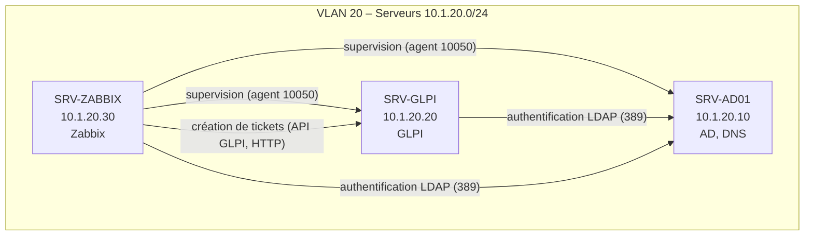
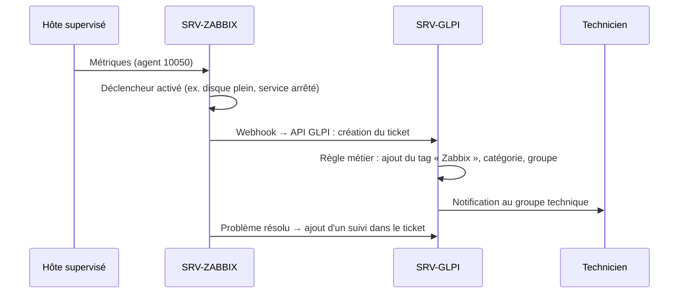

# Séparation des services GLPI et Zabbix sur deux serveurs distincts

## Contexte

L'architecture initiale prévoyait d'héberger **GLPI** (gestion de parc et helpdesk) et **Zabbix** (supervision) sur un même serveur : `SRV-GLPI` (10.1.20.20).

Ce document propose de **séparer ces deux services sur deux serveurs Debian 13 distincts**, en explique les raisons, et décrit comment les deux outils resteront **intégrés** : Zabbix créera automatiquement des tickets dans GLPI.

## Décision

| Serveur | Rôle | Adresse IP | OS |
|---|---|---|---|
| SRV-AD01 | Active Directory, DNS | 10.1.20.10 | Windows Server |
| SRV-GLPI | GLPI (Apache, PHP, MariaDB) | 10.1.20.20 | Debian 13 |
| **SRV-ZABBIX** | **Zabbix Server + Frontend + Agent 2 (Apache, PHP, MariaDB)** | **10.1.20.30** | **Debian 13** |

Les trois serveurs se trouvent dans le **VLAN 20 – Serveurs (10.1.20.0/24)**.

## Justification

### 1. Éviter un point de défaillance unique

Sur un serveur partagé, une seule panne (disque, mise à jour ratée, VM corrompue, saturation de la RAM) **coupe les deux services en même temps** :
- les utilisateurs ne peuvent plus ouvrir de tickets ;
- l'équipe n'est plus alertée des pannes.

Avec deux serveurs, un incident sur l'un **n'affecte pas l'autre**.

### 2. Un outil de supervision ne doit pas dépendre de ce qu'il supervise

C'est l'argument principal. Si Zabbix tourne sur le même serveur que GLPI et que ce serveur tombe, **Zabbix tombe avec lui et aucune alerte n'est envoyée**. La panne passe inaperçue jusqu'à ce qu'un utilisateur la signale.

Sur un serveur séparé, Zabbix **détecte la panne de SRV-GLPI et alerte l'équipe**.

### 3. Pas de concurrence pour les ressources

Zabbix écrit en permanence dans sa base de données (collecte de métriques toutes les 30 à 60 secondes). Sur un serveur partagé, cette charge ralentit GLPI, et un pic d'activité de GLPI peut retarder la collecte de Zabbix.

Séparer les serveurs permet de **dimensionner chaque machine selon son besoin** et d'identifier facilement la cause d'un ralentissement.

### 4. Maintenance indépendante

- Mettre à jour GLPI (version de PHP, plugins) ne risque pas de casser Zabbix, et inversement.
- Un redémarrage pour maintenance ne coupe qu'un seul service.
- Les sauvegardes et restaurations sont plus simples : une VM par service.

### 5. Sécurité : limiter l'impact d'une compromission

Si l'un des services est compromis, l'attaquant n'a pas directement accès à l'autre ni à sa base de données. Les deux bases MariaDB sont séparées, avec des comptes distincts.

## Intégration Zabbix → GLPI : création automatique de tickets

La séparation des deux serveurs n'empêche pas les deux outils de travailler ensemble. **Zabbix créera automatiquement un ticket dans GLPI à chaque alerte**, via l'API REST de GLPI.

### Fonctionnement

1. Un déclencheur Zabbix passe à l'état **Problème** (serveur injoignable, disque plein, service arrêté…).
2. Une **action Zabbix** envoie l'alerte à un **média de type webhook** configuré pour GLPI.
3. Le webhook appelle l'**API REST de GLPI** avec un compte de service dédié (`zabbix-api`) et crée un ticket. Le ticket contient l'hôte concerné, la sévérité, la description du problème et l'heure de détection.
4. Quand le problème disparaît, Zabbix ajoute un **suivi** au ticket pour l'indiquer. Il peut aussi le passer en **Résolu**, selon le choix de l'équipe.

> Zabbix fournit un média de type webhook prêt à l'emploi pour GLPI, mais celui-ci crée par défaut des **Problèmes** (au sens ITIL) et non des **Tickets**. Son script sera adapté pour créer des tickets, ou un webhook personnalisé sera développé.

### Identification des tickets : tag « Zabbix »

Tous les tickets créés par Zabbix porteront un **tag dédié, `Zabbix`**, pour les distinguer des demandes des utilisateurs.

- Le tag est géré par le plugin GLPI **Tag** (à installer depuis le Marketplace de GLPI).
- Il est appliqué automatiquement par une **règle métier pour les tickets** dans GLPI :
  - **Critère** : le demandeur est le compte de service `zabbix-api`
  - **Actions** :
    - ajouter le tag `Zabbix`
    - catégorie : `Supervision`
    - source de la demande : `Zabbix`
    - attribution : groupe `Support technique`
    - urgence déterminée à partir de la sévérité Zabbix (Disaster/High → Très haute/Haute)

Ce marquage permet :
- de **filtrer** rapidement les incidents détectés par la supervision ;
- de créer une **vue ou un tableau de bord dédié** aux alertes ;
- de produire des **statistiques** : nombre d'incidents détectés automatiquement, délai de résolution, hôtes les plus touchés.

> Pour éviter de submerger le helpdesk, seules les alertes d'une **sévérité minimale définie** (ex. `Average` ou plus) créeront un ticket. Les alertes mineures restent visibles uniquement dans Zabbix.

### Prérequis de l'intégration

| Côté | Élément |
|---|---|
| GLPI | API REST activée (Configuration → Générale → API) |
| GLPI | Compte de service `zabbix-api`, avec un profil limité à la création et au suivi de tickets, et son jeton API |
| GLPI | Plugin **Tag**, tag `Zabbix`, catégorie `Supervision`, source `Zabbix`, règle métier |
| Zabbix | Média de type webhook GLPI (URL de l'API, jetons) |
| Zabbix | Action déclenchée sur les problèmes à partir de la sévérité minimale définie |
| Réseau | Flux SRV-ZABBIX → SRV-GLPI sur TCP 80/443 |

## Inconvénients et réponses

| Inconvénient | Réponse |
|---|---|
| Une VM de plus à administrer | Même OS (Debian 13) et même pile logicielle : procédures identiques |
| Plus de ressources consommées | Chaque VM est plus petite, et l'ensemble reste raisonnable (voir ci-dessous) |
| Communication réseau entre les deux services | Simple : même VLAN, ports bien identifiés, échanges via l'API GLPI |

## Ressources prévues

| Serveur | vCPU | RAM | Disque |
|---|---|---|---|
| SRV-GLPI | 2 | 2 à 4 Go | 20 Go |
| SRV-ZABBIX | 2 | 4 Go | 30 Go (historique des métriques) |

## Flux réseau à autoriser

| Source | Destination | Port | Usage |
|---|---|---|---|
| SRV-ZABBIX | Tous les hôtes supervisés | TCP 10050 | Interrogation des agents Zabbix |
| Hôtes supervisés | SRV-ZABBIX | TCP 10051 | Agents actifs vers le serveur Zabbix |
| SRV-ZABBIX | SRV-GLPI | TCP 80/443 | Création et suivi automatiques de tickets via l'API GLPI |
| SRV-GLPI, SRV-ZABBIX | SRV-AD01 | TCP/UDP 53, TCP 389 | DNS, authentification LDAP |
| Postes clients (VLAN utilisateurs) | SRV-GLPI, SRV-ZABBIX | TCP 80/443 | Accès aux interfaces web |

## Enregistrements DNS (sur SRV-AD01)

| Nom | Type | Valeur |
|---|---|---|
| glpi.sap.local | A | 10.1.20.20 |
| zabbix.sap.local | A | 10.1.20.30 |

## Plan d'action

### Infrastructure
- [ ] Créer la VM `SRV-ZABBIX` (Debian 13, 10.1.20.30)
- [ ] Installer Zabbix 8.0 LTS (Server, Frontend, Agent 2, MySQL, Apache)
- [ ] Installer l'agent Zabbix 2 sur SRV-GLPI et SRV-AD01
- [ ] Ajouter les enregistrements DNS sur SRV-AD01
- [ ] Mettre à jour le schéma réseau du projet

### Intégration Zabbix → GLPI
- [ ] Activer l'API REST de GLPI et créer le compte de service `zabbix-api`
- [ ] Installer le plugin Tag dans GLPI et créer le tag `Zabbix`
- [ ] Créer la catégorie `Supervision`, la source `Zabbix` et la règle métier d'attribution du tag
- [ ] Configurer le média webhook GLPI (adapté à la création de tickets) et l'action associée dans Zabbix
- [ ] Tester : provoquer une alerte et vérifier la création du ticket avec le tag `Zabbix`
- [ ] Tester : résoudre l'alerte et vérifier l'ajout du suivi dans le ticket
