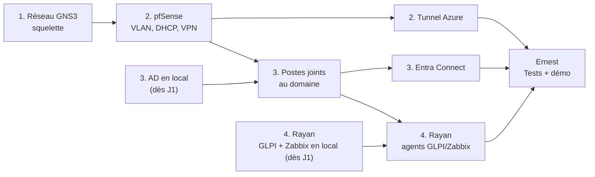

# Rôles du projet : qui fait quoi sur la maquette

Ce document répartit le travail de la maquette (voir [TOPOLOGIE.md](../proposition_logiciel_maquette/TOPOLOGIE.md)) entre les 5 membres du groupe. **Ernest est chef de projet** : il coordonne et porte la documentation. Les 4 autres membres possèdent chacun **une** brique technique.

**Effectif : 5 personnes.** Ernest (chef de projet, et rôle 2 Pare-feu et Azure) + Gabriel et Nicolas (rôle 1 Réseau, en duo) + Matthieu (rôle 3 Windows) + Rayan (rôle 4 Services) = 5.

## Vue d'ensemble

| Rôle | Qui | Difficulté | Charge | Avec qui il travaille |
|---|---|---|---|---|
| **Chef de projet** | Ernest | ★☆☆ technique, ★★★ organisation | Élevée | Tout le monde  |
| **1. Réseau GNS3** | Gabriel et Nicolas | ★★★ difficile | Élevée | Travaillent avec Ernest (réseau et pare-feu sont liés) |
| **2. Pare-feu et Azure** | Ernest (en plus du pilotage) | ★★★ difficile | Élevée | Travaille avec Gabriel et Nicolas |
| **3. Serveurs Windows** | Matthieu | ★★☆ moyen | Moyenne |  fournit l'AD aux rôles 2 et 4 |
| **4. Services et supervision** |  | ★★☆ moyen, le plus guidé | Moyenne |

Comment choisir :
- **Rôle 1** : la personne la plus à l'aise en réseau (VLAN, routage, Cisco).
- **Rôle 2** : quelqu'un de curieux et patient. C'est la brique la plus délicate (tunnel IPsec, NAT, Azure). Ernest ne fait pas la technique, il suit seulement le coût Azure pour le budget.
- **Rôle 3** : quelqu'un qui connaît Windows Server, ou qui veut l'apprendre (c'est le cœur du métier d'ASR).
- **Rôle 4 : Rayan.** C'est la brique la plus guidée : des logiciels avec des procédures d'installation officielles pas à pas, peu de dépendances au début.

**Règle d'or : une seule maquette de référence.** Tout est assemblé sur **un PC costaud** (32 Go de RAM si possible, 16 Go minimum), appelé « PC maquette ». Chacun prépare et teste ses VM chez lui, puis les exporte (format `.ova`) sur le PC maquette.

---

## Chef de projet : Ernest

**Difficulté** : ★☆☆ technique, ★★★ organisation · **1 personne** · **charge élevée**

### Responsabilités
- Organiser l'équipe : RACI, planning, tableau de suivi d'avancement, registre des risques (exigés par le Contexte SAP, §1.3).
- Tenir le dépôt GitHub : README, dossiers de chaque partie, relecture avant merge.
- Mettre à jour le schéma d'infrastructure, le budget et le planning à chaque partie.
- Préparer la soutenance : PowerPoint commun, déroulé de la démo, répartition de la parole.
- Faire passer la **checklist de tests** (TOPOLOGIE.md, étape 7) avant la soutenance.
- **Suivi du coût Azure** : Ernest porte aussi le rôle 2, il crée donc l'abonnement et vérifie le coût dans *Cost Management* pour le budget.

### À installer
- [diagrams.net](https://app.diagrams.net) (en ligne ou draw.io Desktop), Excel ou LibreOffice, PowerPoint.
- Git (ou GitHub Desktop) pour mettre à jour le dépôt.
- Un accès en lecture à l'abonnement Azure du groupe (donné par le membre B).

### Comment faire
1. Au lancement : faire choisir les rôles, remplir le tableau RACI ci-dessous, créer le tableau de suivi (un tableau GitHub *Projects* ou un simple Excel : tâche, responsable, état, date).
2. Chaque jour : un point de 10 minutes le matin (fait hier, à faire aujourd'hui, blocages) et la mise à jour du tableau.
3. Débloquer : si une brique bloque plus d'une demi-journée, demander au membre le plus avancé de donner un coup de main pendant une heure. On garde chaque rôle à son propriétaire, on prête juste de l'aide.
4. Fin de semaine : récupérer les captures d'écran et les configurations de chacun, finaliser le PowerPoint, faire une répétition générale de la démo.

### Livrables
Dossier de pilotage (RACI, planning, suivi, risques), README à jour, schémas, budget, PowerPoint de soutenance.

---

## Rôle 1 : Réseau GNS3 (Gabriel et Nicolas)

**Difficulté** : ★★★ difficile · **Gabriel et Nicolas** · **charge élevée** · **duo avec le rôle 2**

### Responsabilités
Construire le « squelette » de la maquette dans GNS3 : Internet simulé, sites, switchs et VLAN.

### À installer (sur son PC, puis sur le PC maquette)
| Logiciel | Version conseillée | Remarque |
|---|---|---|
| GNS3 (client) | dernière 2.2.x stable | gratuit |
| GNS3 VM | même version que le client, obligatoirement | dans VMware Workstation (le plus stable) ou VirtualBox |
| VMware Workstation Pro | dernière | gratuit (compte Broadcom pour le téléchargement) |
| VyOS (appareil GNS3) | image fournie par le Marketplace GNS3 | joue le routeur R-FAI |
| VPCS | inclus dans GNS3 | postes et imprimante simulés |

RAM : 2 à 4 Go pour la GNS3 VM et 512 Mo pour VyOS.

### Comment faire
1. Installer VMware Workstation, puis GNS3 et la GNS3 VM. Vérifier dans GNS3 que la VM est bien « verte » (démarrée).
2. Importer l'appareil **VyOS** depuis le Marketplace (*File → New template → Install an appliance from the GNS3 server*).
3. Créer le projet `SAP-maquette` : nœud NAT, R-FAI, deux *Ethernet switch* (SW-LILLE, SW-PARIS), quelques VPCS.
4. Configurer R-FAI avec les commandes de TOPOLOGIE.md (étape 3), et vérifier qu'il sort sur Internet : `ping 8.8.8.8`.
5. Configurer les switchs : port vers le pfSense en **dot1q**, ports des machines en **access** (VLAN 10, 20, 40).
6. Laisser des emplacements pour les pfSense (rôle 2) et les VM (rôles 3 et 4), puis exporter le projet GNS3 (*File → Export portable project*) pour le PC maquette.
7. Écrire la fiche « plan d'adressage et câblage » (reprendre le tableau de TOPOLOGIE.md, avec les ports réellement utilisés).

### Dépendances
- Bloque tout le monde au début : le squelette doit être prêt **en premier** (J1).
- Travaille avec le rôle 2 pour brancher les pfSense entre R-FAI et les switchs.

### Livrables
Projet GNS3 exporté, configuration de VyOS, fiche d'adressage et de câblage, captures d'écran.

---

## Rôle 2 : Pare-feu et Azure (Ernest)

**Difficulté** : ★★★ difficile, la brique la plus délicate · **Ernest** · **charge élevée** · **duo avec le rôle 1**

### Responsabilités
Les pfSense des sites (VLAN, DHCP, règles, VPN entre sites) et toute la partie Azure (réseau, VM, tunnel).

### À installer
| Logiciel | Version conseillée | Remarque |
|---|---|---|
| pfSense CE | dernière 2.7.x stable | appareil GNS3 ou VM VMware (1 Go de RAM chacun) ; OPNsense convient aussi |
| Compte Azure for Students | | avec l'adresse mail de l'école, environ 100 $ de crédit |
| Azure CLI (facultatif) | dernière | utile pour créer la passerelle VPN en ligne de commande |
| WireGuard (plan B) | | si l'IPsec ne passe pas les NAT |

### Comment faire
1. **pfSense-LILLE et pfSense-PARIS** : WAN, VLAN, adresses en `.1`, DHCP sur le VLAN 10 (TOPOLOGIE.md, étape 4).
2. Vérifier le routage entre VLAN : un VPCS du VLAN 10 doit pinguer la passerelle du VLAN 20.
3. Monter le **tunnel IPsec Lille ↔ Paris**, puis vérifier qu'un VPCS de Paris pingue un VPCS de Lille.
4. Écrire les **règles de pare-feu** minimales (utilisateurs → serveurs sur les ports utiles, le reste bloqué) et les documenter : elles serviront à la partie 3.
5. **Azure** : créer le compte Azure for Students, le groupe de ressources `RG-SAP-MAQUETTE` en France Central, **poser une alerte budget**, puis créer le VNet 10.100.0.0/16, la VM-AZ01 et le point d'entrée VPN (TOPOLOGIE.md, étape 6).
6. Monter le **tunnel Lille ↔ Azure**, lancé par pfSense. Si ça ne monte pas après une demi-journée, passer au plan B WireGuard sans attendre.
7. Arrêter les VM Azure et supprimer la passerelle VPN entre deux séances de travail, pour ne pas consommer le crédit.

### Dépendances
- A besoin du squelette du rôle 1 (J1).
- Le rôle 3 a besoin du DHCP et du routage pour mettre les serveurs et les postes en réseau.
- Le tunnel Azure n'a besoin de personne d'autre : il peut avancer en parallèle dès J2.

### Livrables
Configurations pfSense exportées (*Diagnostics → Backup*), tableau des règles de pare-feu, captures des tunnels « up », fiche Azure (ressources créées, coût consommé).

---

## Rôle 3 : Serveurs Windows (Matthieu)

**Difficulté** : ★★☆ moyen · **Matthieu** · **charge moyenne** .

### Responsabilités
L'annuaire et les services Windows : Active Directory, DNS, GPO, poste client, synchronisation vers Entra ID.

### À installer
| Logiciel | Version conseillée | RAM |
|---|---|---|
| Windows Server 2022 ou 2025 | version d'évaluation gratuite (180 jours) | 4 Go |
| Windows 10/11 Entreprise | version d'évaluation gratuite (90 jours) | 4 Go |
| Microsoft Entra Connect (ou Entra Cloud Sync) | dernière | installé sur SRV-AD01 |

### Comment faire
1. Créer la VM **SRV-AD01** chez soi : adresse fixe 10.1.20.10, passerelle 10.1.20.1, DNS sur elle-même.
2. Installer les rôles **AD DS** et **DNS**, créer le domaine (par exemple `sap.local`).
3. Créer l'arborescence : une **OU par site** (Lille, Paris…) et une **OU par service** (éducateurs, psychologues, administratifs, direction), puis des groupes et une dizaine d'utilisateurs de test.
4. Écrire 2 ou 3 **GPO** simples et visibles en démo : fond d'écran SAP, verrouillage de session après 10 minutes, politique de mot de passe.
5. Créer la VM **PC-LILLE** et la joindre au domaine (une fois branchée sur le VLAN 10 du PC maquette).
6. Exporter les VM en `.ova` et les importer sur le PC maquette, dans les bons VLAN.
7. Avec le rôle 2 : installer **Entra Connect** sur SRV-AD01 et synchroniser les utilisateurs vers le tenant Azure, puis activer le MFA pour un utilisateur de démo.

### Dépendances
- Peut commencer **dès J1, chez soi**, sans attendre le réseau (étapes 1 à 4).
- A besoin du réseau (rôles 1 et 2) pour joindre le poste au domaine (étape 5).
- Le rôle 4 a besoin de l'AD pour l'authentification GLPI et l'inventaire.

### Livrables
VM exportées, document « annuaire » (OU, groupes, utilisateurs), liste des GPO avec captures, capture de la synchronisation vers Entra ID.

---

## Rôle 4 : Services et supervision (Rayan)

**Difficulté** : ★★☆ moyen, le rôle le plus guidé · **1 personne** · **charge moyenne** ·

### Responsabilités
Les services Linux : GLPI (parc et tickets ITIL), Zabbix (supervision), les sauvegardes, et les éléments simulés (imprimante, poste de Paris).

### À installer
| Logiciel | Version conseillée | RAM |
|---|---|---|
| Debian | dernière stable | 2 Go (VM SRV-GLPI) |
| GLPI | dernière stable | sur SRV-GLPI (Apache, PHP, MariaDB) |
| Zabbix | version LTS (7.0) | sur SRV-GLPI (serveur + interface web) |
| Agent GLPI et agent Zabbix | | sur SRV-AD01 et PC-LILLE |

### Comment faire
1. Créer la VM **SRV-GLPI** (Debian) chez soi : adresse fixe 10.1.20.20, passerelle 10.1.20.1.
2. Installer **GLPI**, puis créer les entités (un site = une entité) et les catégories de tickets. Préparer 2 ou 3 tickets de démo (incident, demande).
3. Installer **Zabbix** et ajouter les hôtes à superviser : les deux pfSense (SNMP), SRV-AD01 et PC-LILLE (agent).
4. Une fois sur le PC maquette : installer les agents GLPI et Zabbix sur les machines Windows
5. Mettre en place une **sauvegarde simple** : une sauvegarde quotidienne de la base GLPI et des configurations pfSense, et une restauration testée au moins une fois (argument PRA).
6. Ajouter les VPCS (IMP-LILLE 10.1.40.10, PC-PARIS) et vérifier qu'ils apparaissent dans Zabbix (ping ICMP).
7. Facultatif, si le crédit Azure le permet : envoyer une sauvegarde vers Azure Blob Storage.

### Pour bien démarrer (Rayan)
- **Ordre à suivre** : Debian d'abord, puis GLPI, puis Zabbix. Ne passe à l'étape suivante que quand la précédente marche.
- **Suis les procédures officielles** : la documentation d'installation de GLPI, et la page *Download* de zabbix.com, où tu choisis ta version de Debian et le site te donne les commandes exactes à copier.
- **Paquets de base pour GLPI** sur Debian :
  ```
  sudo apt update
  sudo apt install apache2 mariadb-server php php-mysql php-xml php-curl php-gd php-intl php-mbstring php-zip php-ldap php-bz2
  ```
- **Prends une capture d'écran à chaque étape réussie** : elles servent pour la doc et la soutenance.
- **Fais un snapshot de la VM** avant chaque grosse étape. Si ça casse, tu reviens en arrière en un clic.
- **Bloqué plus d'une heure ?** Demande à ton parrain (Matthieu), puis à Ernest au point du soir.
- **Si le temps manque**, la priorité est GLPI qui fonctionne, puis Zabbix qui supervise au moins les deux pfSense par ping.

### Dépendances
- Peut commencer **dès J1, chez soi** (étapes 1 à 3, en local).
- A besoin du réseau (rôles 1 et 2) et de l'AD (rôle 3) pour les étapes 4 à 6.

### Livrables
VM exportée, tableau de bord Zabbix (capture), GLPI avec le parc remonté, procédure de sauvegarde et preuve de restauration.

---

## Qui dépend de qui



Ce qu'il faut retenir : **les rôles 3 et 4 n'attendent pas** le réseau pour commencer. Ils montent leurs serveurs chez eux pendant que les rôles 1 et 2 posent le réseau.

## Planning conseillé (semaine de 5 jours)

| Moment | Ernest (chef de projet) | Gabriel et Nicolas : 1. Réseau | Ernest : 2. Pare-feu / Azure | Matthieu : 3. Windows | Rayan : 4. Services |
|---|---|---|---|---|---|
| **Avant la semaine** | Rôles, RACI, tableau de suivi, choix du PC maquette | Installer GNS3 + GNS3 VM | Créer le compte Azure et l'alerte budget | Télécharger les ISO Windows | Télécharger l'ISO Debian, installer une Debian d'essai avec son parrain |
| **J1** | Lancement, point du soir (dont Rayan) | Squelette GNS3 + R-FAI | pfSense Lille et Paris (WAN, VLAN) | SRV-AD01 en local (AD, DNS) | SRV-GLPI en local (GLPI) |
| **J2** | Suivi, début du PowerPoint | Switchs, VLAN, export du projet | DHCP, règles, tunnel Lille ↔ Paris | OU, utilisateurs, GPO | Zabbix en local |
| **J3** | Assemblage sur le PC maquette avec tous | Assemblage, câblage final | Tunnel Azure (plan B si besoin) | Import des VM, PC-LILLE joint au domaine | Import, agents, supervision (avec le parrain) |
| **J4** | Checklist de tests, répétition de la démo | Corrections | Finir Azure, mesurer le coût | Entra Connect + MFA | Sauvegarde + test de restauration |
| **J5** | Soutenance | Soutenance | Soutenance, puis suppression des ressources Azure | Soutenance | Soutenance |

## RACI

R = réalise, A = valide (responsable final), C = consulté, I = informé.

| Tâche | Ernest (chef de projet) | Gabriel et Nicolas (Réseau) | Ernest (Pare-feu/Azure) | Matthieu (Windows) | Rayan (Services) |
|---|---|---|---|---|---|
| Planning, suivi, risques | A/R | I | I | I | I |
| Squelette GNS3, VLAN | A | R | C | I | I |
| pfSense, règles, VPN entre sites | A | C | R | I | I |
| Compte et ressources Azure | A | I | R | I | I |
| Suivi du coût Azure dans le budget | A/R | I | C | I | I |
| Tunnel vers Azure | A | C | R | I | I |
| Active Directory, GPO | A | I | I | R | C |
| Entra Connect | A | I | C | R | I |
| GLPI, Zabbix, sauvegardes | A | I | C | C | R |
| Assemblage sur le PC maquette | A/R | R | R | R | R |
| Documentation et README | A/R | C | C | C | C |
| Soutenance | A/R | R | R | R | R |

## Risques à surveiller

| Risque | Probabilité | Impact | Parade |
|---|---|---|---|
| Le tunnel IPsec vers Azure ne monte pas (NAT, CGNAT) | Élevée | Moyen | Plan B WireGuard dès J3 midi ; sinon, démo réseau de l'école |
| Le PC maquette manque de RAM | Moyenne | Élevé | N'allumer que les VM utiles ; PC-PARIS en VPCS ; viser 32 Go |
| Le crédit Azure est épuisé | Moyenne | Moyen | Alerte budget, arrêt des VM, suppression de la passerelle après chaque séance |
| Versions GNS3 client / GNS3 VM différentes | Moyenne | Moyen | Même version partout, vérifiée avant la semaine |
| Une brique n'est pas prête le jour de la démo | Moyenne | Élevé | Captures d'écran et vidéo de secours faites dès J4 |
| Rayan bloqué sur une étape | Moyenne | Moyen | Parrain (Matthieu) à appeler après 1 h de blocage, point du soir avec Ernest, priorités définies (GLPI d'abord) |
| Membre absent | Faible | Moyen | Chaque rôle documente ses étapes au fil de l'eau (configurations sur GitHub) |

## Règles de travail en équipe

- **Tout ce qui est configuré est noté** : chaque membre dépose ses configurations, captures et procédures dans le dépôt GitHub (un dossier par rôle dans la partie 2).
- **Pas de vraies données** : uniquement des comptes et des fichiers fictifs.
- **Mots de passe** : jamais dans GitHub. Un fichier partagé hors du dépôt, ou un gestionnaire de mots de passe.
- **Point quotidien de 10 minutes**, et toute difficulté bloquante est signalée à Ernest dans la demi-journée.
