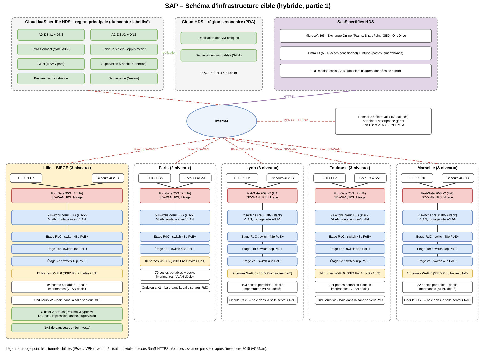
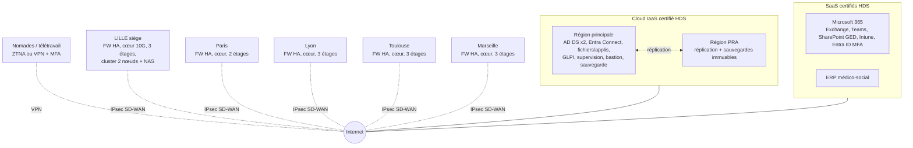

# Partie 1 – Modéliser les infrastructures systèmes et réseaux

> Mission : réaliser un schéma d'infrastructure global de la solution, définir les équipements à renouveler ou remplacer, budgétiser et organiser leur implantation.

Fichiers de cette partie :

| Fichier | Contenu |
|---|---|
| [`schema_infrastructure.png`](schema_infrastructure.png) / [`.pdf`](schema_infrastructure.pdf) | Schéma global à consulter ou insérer dans le PowerPoint |
| [`schema_infrastructure.drawio`](schema_infrastructure.drawio) | Même schéma, version modifiable (voir ci-dessous) |
| [`budget_partie1.xlsx`](budget_partie1.xlsx) | Budget avec formules : onglet *Hypothèses* modifiable (cellules jaunes), le reste se recalcule |

**Modifier le schéma :** télécharger `schema_infrastructure.drawio`, aller sur [app.diagrams.net](https://app.diagrams.net), choisir « Appareil » comme emplacement d'enregistrement, puis *Fichier → Ouvrir depuis → Appareil* et sélectionner le fichier (ou le glisser-déposer dans la page). Export pour le PowerPoint : *Fichier → Exporter en → PNG*. Alternatives : l'application draw.io Desktop, ou l'extension VS Code « Draw.io Integration ».

---

## 1. Ce que disent les documents (synthèse de l'existant)

**L'entreprise.** SAP, secteur social, 5 sites : Lille (siège : DG, DAF, DRH, pôle IT au 2e étage), Paris, Lyon, Toulouse, Marseille. 450 salariés (+5 %/an sur 5 ans), 1 750 usagers suivis, 3 500 dossiers/mois. Les dossiers contiennent des évaluations psychologiques et un suivi médical : ce sont des **données de santé**.

**L'équipe projet.** Le RSI et un alternant (le groupe = l'alternant). Tout doit être dimensionné pour être exploitable par deux personnes.

**Exigences (Contexte SAP §10.2).** HDS, RGPD, ISO 27001, ISO 22301, ITIL, disponibilité 99,9 % (8 h 45 d'arrêt par an maximum), PRA/PCA, supervision, accès distant, GreenIT (datacenter labellisé), fin de projet à démarrage + 8 mois, budget à chaque étape (investissement, 1 an de charges, coûts internes/externes, réserves).

**Budget.** Le Contexte SAP indique une enveloppe de **800 000 €** avec « vigilance sur les charges d'exploitation ». Le rapport IT Conseils dit « aucune contrainte de budget » : on retient 800 k€ comme cible, c'est l'hypothèse la plus prudente.

**Inventaire 2015 : tout est en fin de vie.**

| Élément | Existant | État | Décision |
|---|---|---|---|
| Postes | 450 HP ProBook 450 G2 (2015) | 154 à remplacer, 146 défectueux, 150 en service | **Remplacer 100 %** : CPU non compatibles Windows 11, Windows 10 hors support depuis oct. 2025 |
| Licences | 450 Office 2013 | hors support | **Remplacer** par Microsoft 365 |
| Smartphones | 135 Galaxy A5 | 47 batterie faible, 45 écran cassé | **Remplacer**, gestion par MDM (Intune) |
| Souris | 450 Logitech M185 | 160 perdues, 148 à remplacer | Remplacer (kit) |
| Switchs | 3 HP 5120 par site (15) | 2015, « vieillissant » | **Remplacer** (PoE+ pour Wi-Fi, redondance cœur) |
| Routeurs | 1 Cisco ASR 900 par site | 2015, surdimensionné et sans redondance | **Supprimer** : le pare-feu SD-WAN fait le routage WAN |
| Pare-feu | 1 Check Point 3200 par site | 2015, point unique de panne | **Remplacer** par une paire HA |
| Serveurs | 16 HP G7 (DL380/DL360/ML110), ESXi 5.5 | 2010-2011, hors support | **Retirer** ; 2 serveurs neufs au siège seulement |
| Sauvegarde | LTO6 local par site | pas d'externalisation, pas de PRA | Remplacer par sauvegarde 3-2-1 externalisée HDS |
| VM | Windows 2012 R2, Exchange 2010, Debian 7 | tous hors support | Migrer (cloud HDS, M365, ERP SaaS) |
| Adressage | IP incohérentes (10.x, 172.x, 192.168.x mélangés sur un même site) | | Plan d'adressage à refaire (partie 2) |
| Wi-Fi | absent de l'inventaire | | **Créer** : bornes Wi-Fi 6 sur tous les étages |

---

## 2. HDS : pourquoi l'hybride est le bon choix (avec une nuance)

La certification HDS (art. L.1111-8 du Code de la santé publique) s'impose à **l'hébergeur** qui stocke des données de santé pour le compte d'un tiers. Si SAP gardait tout dans ses propres salles serveurs, elle n'aurait pas besoin d'être certifiée HDS, mais elle devrait assurer elle-même un niveau équivalent (ISO 27001, PRA, 99,9 %), avec 5 salles serveurs et 2 personnes : ce n'est pas tenable.

Le raisonnement à présenter au jury est donc : **les données de santé partent chez des hébergeurs certifiés HDS** (le poids de la certification est porté par eux), et on ne garde en local que ce qui doit être proche des utilisateurs. C'est ça, l'hybride. Points à citer : contrat d'hébergement HDS, données hébergées dans l'UE, réversibilité, label environnemental du datacenter (exigence GreenIT du Contexte §9).

---

## 3. Trois options d'architecture

| | A. Tout sur site (rénové) | **B. Hybride (recommandée)** | C. Tout cloud |
|---|---|---|---|
| Principe | Datacenter principal Lille + secours Paris, serveurs et SAN neufs | Données de santé et applis critiques en cloud/SaaS HDS, réseau neuf sur site, petit cluster au siège | Plus aucun serveur sur site, sites = réseau seulement |
| HDS | Auto-hébergement : SAP porte toute la conformité | Porté par les hébergeurs certifiés | Porté par les hébergeurs certifiés |
| 99,9 % / PRA | Difficile : 2 salles à maintenir, PRA à construire | Natif chez l'hébergeur (2 régions) + double lien par site | Natif, mais dépend à 100 % d'Internet |
| Exploitation à 2 personnes | Très lourde (astreintes, matériel) | Raisonnable | La plus légère |
| CAPEX / OPEX | CAPEX très élevé | Équilibré | CAPEX faible, OPEX le plus élevé |
| GreenIT | 5 salles à refroidir | Salles réduites à des baies réseau | Idem B |
| Intérêt pédagogique (parties 2 et 3) | Fort | Fort : AD, DNS, DHCP, VPN, supervision restent à configurer | Plus faible : peu de serveurs à monter |

**Coûts théoriques des trois options :** voir [`couts_options/`](couts_options/README.md). Sur 5 ans : A ≈ 2,28 M€, B ≈ 1,99 M€, C ≈ 2,16 M€.

**Recommandation : option B.** Elle répond à HDS, au 99,9 % et à la taille de l'équipe, et garde assez de serveurs pour les parties 2 et 3 (déployer, puis maintenir et sécuriser).

---

## 4. Architecture cible (option B)

Schéma complet et éditable : [`schema_infrastructure.drawio`](schema_infrastructure.drawio).

**Les choix, couche par couche :**

- **WAN.** Chaque site a une fibre dédiée FTTO 1 Gb/s et un lien de secours (FTTH pro ou 4G/5G). Les pare-feu font du SD-WAN : ils basculent seuls sur le secours. Des tunnels IPsec relient chaque site au cloud HDS et au siège. On supprime les routeurs ASR 900.
- **Sécurité périmétrique.** Une paire de pare-feu en haute disponibilité par site (Fortinet FortiGate dans le budget ; alternative : Stormshield, constructeur français qualifié ANSSI, un bon argument de souveraineté). IPS, filtrage web, VPN nomades.
- **LAN.** Deux switchs cœur 10G empilés dans la salle serveur du RdC, un switch d'accès 48 ports PoE+ par étage (salle info), en double uplink vers le cœur. VLAN par usage : utilisateurs, administration, Wi-Fi pro, invités, imprimantes, IoT/téléphonie, management.
- **Wi-Fi.** Bornes Wi-Fi 6/6E, environ une pour 200 m² (76 au total, à confirmer par un audit radio), SSID Pro en 802.1X, SSID Invités isolé.
- **Serveurs.** Les VM d'infrastructure (AD DS x2, Entra Connect, fichiers, GLPI, supervision, bastion, sauvegarde) vont en IaaS HDS, avec réplication vers une 2e région pour le PRA. Au siège seulement, un cluster de 2 nœuds (DC local, impression, cache, supervision locale) et un NAS de sauvegarde de 1er niveau. Les autres sites n'ont plus de serveur.
- **Applicatif.** Microsoft 365 (certifié HDS en France) pour la messagerie, Teams, la GED SharePoint et Intune ; un ERP médico-social en SaaS HDS remplace l'ERP actuel et supprime les ressaisies.
- **Postes et mobilité.** 100 % renouvelés, inscrits dans Intune (Autopilot), chiffrement BitLocker, MFA. Smartphones gérés en Android Enterprise.
- **Sauvegarde.** Règle 3-2-1 : production cloud, copie dans la région PRA (immuable), copie locale sur le NAS du siège pour les données locales.
- **Supervision.** Zabbix ou Centreon pour l'infrastructure, GLPI pour le parc et les tickets ITIL (détaillé en partie 3).

---

## 5. Implantation par site

Les cinq sites suivent le même modèle, ce qui simplifie le déploiement et la maquette.

| Site | Niveaux | Surface / niveau | Salariés (2015) | Switchs d'accès | Bornes Wi-Fi | Particularité |
|---|---|---|---|---|---|---|
| Lille | 3 | 20 × 48 m | 94 + siège | 3 | 15 | Siège : pare-feu 90G, cluster 2 nœuds + NAS |
| Paris | 2 | 33 × 30 m | 70 | 2 | 10 | |
| Lyon | 3 | 17 × 36 m | 103 | 3 | 9 | |
| Toulouse | 3 | 24 × 68 m | 101 | 3 | 24 | Bâtiment le plus long : bornes réparties sur les 2 ailes |
| Marseille | 3 | 28 × 46 m | 82 | 3 | 18 | |

- **Salle serveur du RdC (existante sur chaque plan)** : baie avec les pare-feu HA, les switchs cœur, les onduleurs et l'arrivée des opérateurs ; à Lille, aussi le cluster et le NAS.
- **Salle info de chaque étage** : switch d'accès, alimentation ondulée, brassage Cat6A.
- **Bornes** : plafond des couloirs centraux et des grands bureaux éducateurs, câblées en PoE+.

---

## 6. Budget (résumé, HT, indicatif)

Le détail et les formules sont dans [`budget_partie1.xlsx`](budget_partie1.xlsx). Les prix sont des ordres de grandeur publics à faire confirmer par des devis.

| | Scénario complet | Scénario économe |
|---|---|---|
| Investissement | 746 k€ | 566 k€ |
| Charges 1re année | 237 k€ | 172 k€ |
| Coûts internes (RSI + alternant) | 54 k€ | 54 k€ |
| Réserves contingence 10 % + management 5 % | 148 k€ | 111 k€ |
| **Total** | **1 185 k€** | **903 k€** |
| Écart avec l'enveloppe de 800 k€ | +385 k€ | +103 k€ |

Le scénario économe applique quatre leviers : 40 % de postes reconditionnés (aussi un argument RSE), renouvellement en année 1 des seuls postes HS (65 % du parc) et du reste en année 2, ERP porté par le budget métier, et seulement les 92 smartphones HS remplacés.

**Message à faire passer au COPIL :** 800 k€ ne suffisent pas pour tout renouveler et payer la première année d'exploitation. Il faut un arbitrage. Pour combler l'écart restant, le levier le plus fort est la location évolutive des postes (DaaS), qui transforme environ 370 k€ d'investissement en une charge mensuelle.

---

## 7. Organisation du déploiement (8 mois)

| Mois | Étape |
|---|---|
| M1 | Cadrage, validation COPIL, devis et commandes, audit Wi-Fi, contrats HDS |
| M2 | Tenant Microsoft 365, Entra ID et Intune ; IaaS HDS (AD, supervision, sauvegarde) ; tunnels IPsec |
| M3 | **Pilote Lille** (siège) : réseau, Wi-Fi, cluster, 30 postes pilotes |
| M4 | Paris, puis Lyon (une semaine de bascule par site, le week-end) |
| M5 | Toulouse, puis Marseille |
| M4-M6 | Migration Exchange 2010 vers M365, ERP vers SaaS, déploiement des postes par vagues avec formation |
| M7 | Test PRA (bascule sur la région secondaire), recette, mesure de la disponibilité |
| M8 | Retrait des anciens serveurs et routeurs, effacement certifié et recyclage DEEE, bilan |

Chaque bascule de site suit la même fiche : pré-installation de la baie pendant la semaine, bascule des liens et du LAN le week-end, accueil utilisateurs le lundi, ancien matériel conservé 2 semaines pour pouvoir revenir en arrière.

---

## 8. La maquette : Packet Tracer ou pas ?

**Pas en « full Packet Tracer ».** Packet Tracer est très bien pour le réseau mais ne sait pas faire le reste :

| Packet Tracer sait faire | Packet Tracer ne sait pas faire |
|---|---|
| VLAN, trunk, inter-VLAN, OSPF, HSRP, ACL, NAT | Un vrai Active Directory, des GPO, Windows Server |
| VPN IPsec site à site (routeurs ISR), ASA 5506 basique | Fortinet/Stormshield, SD-WAN, ZTNA |
| Contrôleur Wi-Fi et bornes, DHCP, DNS, serveur HTTP/AAA simplifiés | Le cloud, Microsoft 365, Intune, les hyperviseurs |
| Simulation multi-sites légère | La supervision (Zabbix), GLPI, la sauvegarde |

Trois options pour la maquette :

1. **Packet Tracer seul.** Le plus simple, mais toute la partie serveurs et sécurité devient symbolique. À réserver si le temps manque.
2. **Packet Tracer + VM (recommandée).** Packet Tracer pour la topologie réseau des 5 sites (Lille détaillé, les 4 autres copiés du même gabarit), et VirtualBox, VMware Workstation ou Proxmox pour les serveurs : Windows Server (AD, DNS, DHCP), pfSense ou OPNsense à la place du FortiGate (VPN IPsec, règles), Zabbix, GLPI. C'est réaliste, gratuit et faisable sur un PC portable avec 16 Go de RAM.
3. **GNS3 ou EVE-NG.** Le plus réaliste (vraies images routeurs et pare-feu, VM intégrées), mais lourd à installer, gourmand en RAM et les images constructeur posent des questions de licence. À envisager seulement si quelqu'un du groupe le maîtrise déjà.

**Pour la partie 1, la maquette n'est pas le livrable** : le schéma draw.io, la liste d'équipements, le budget et le planning suffisent. Une topologie Packet Tracer simplifiée (Lille + un site + un « cloud » représenté par un serveur) peut servir d'aperçu à la soutenance, puis devient la base de la partie 2 (adressage et routage).

**Équivalences maquette ↔ cible :** FortiGate → ASA 5506 (Packet Tracer) ou pfSense (VM) ; switchs cœur → 3650 ; switchs d'accès → 2960 ; bornes → WLC + LAP ; cloud HDS → un serveur derrière un routeur « Internet ».
