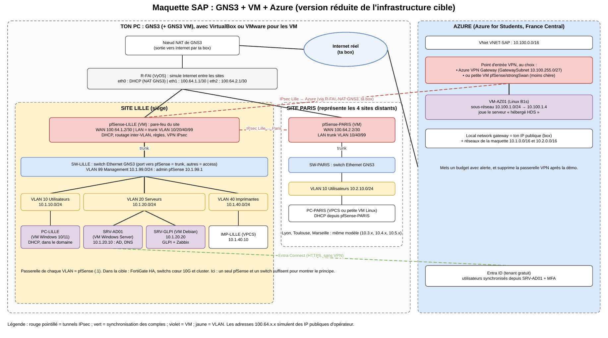

# Topologie de la maquette : GNS3 + VM + Azure



Schéma modifiable : [`topologie_maquette.drawio`](topologie_maquette.drawio), à ouvrir sur [app.diagrams.net](https://app.diagrams.net) (*Fichier → Ouvrir depuis → Appareil*).

## L'idée en une phrase

On reproduit **en petit** l'infrastructure cible sur un seul PC. GNS3 dessine le réseau (Internet simulé, deux sites, VLAN), les VM jouent les pare-feu, les serveurs et les postes, et un tunnel chiffré relie le siège à un vrai réseau Azure. C'est ça, la démonstration de l'hybride.

## Qui joue quel rôle

| Dans la maquette | Ce que ça représente dans la vraie solution |
|---|---|
| **R-FAI** (routeur VyOS) | Internet et les opérateurs : il relie les sites entre eux comme le ferait la fibre |
| **Nœud NAT de GNS3** | La sortie vers le vrai Internet (par la box de ton PC) |
| **pfSense-LILLE** (VM) | La paire de FortiGate du siège : pare-feu, routage entre VLAN, DHCP, VPN |
| **SW-LILLE** (switch Ethernet de GNS3) | Les switchs cœur et d'accès du siège |
| **SRV-AD01** (VM Windows Server) | L'annuaire Active Directory et le DNS |
| **SRV-GLPI** (VM Debian) | Le parc et les tickets (GLPI) et la supervision (Zabbix) |
| **PC-LILLE** (VM Windows) | Un poste d'un salarié du siège |
| **IMP-LILLE** (VPCS) | Une imprimante (VPCS est un mini-PC intégré à GNS3, il ne consomme presque rien) |
| **pfSense-PARIS** + SW-PARIS + PC-PARIS | Un site distant. Lyon, Toulouse et Marseille seraient des copies identiques |
| **Azure** : VNet + VM-AZ01 | L'hébergeur cloud certifié HDS |
| **Entra ID** | Les comptes cloud (Microsoft 365, MFA) synchronisés depuis l'AD |

## Plan d'adressage

Règle simple : **10.[numéro du site].[numéro du VLAN].0/24**, avec la passerelle en `.1` (le pfSense du site).

| Réseau | Adresse | Passerelle | Contient |
|---|---|---|---|
| Lille – VLAN 10 Utilisateurs | 10.1.10.0/24 | 10.1.10.1 | PC-LILLE (DHCP .100 à .200) |
| Lille – VLAN 20 Serveurs | 10.1.20.0/24 | 10.1.20.1 | SRV-AD01 .10, SRV-GLPI .20 (adresses fixes) |
| Lille – VLAN 40 Imprimantes | 10.1.40.0/24 | 10.1.40.1 | IMP-LILLE .10 |
| Lille – VLAN 99 Management | 10.1.99.0/24 | 10.1.99.1 | Interface d'admin du pfSense |
| Paris – VLAN 10 Utilisateurs | 10.2.10.0/24 | 10.2.10.1 | PC-PARIS (DHCP) |
| Lien R-FAI ↔ Lille | 100.64.1.0/30 | | R-FAI .1, pfSense-LILLE .2 |
| Lien R-FAI ↔ Paris | 100.64.2.0/30 | | R-FAI .1, pfSense-PARIS .2 |
| Azure – VNet | 10.100.0.0/16 | | |
| Azure – sous-réseau des VM | 10.100.1.0/24 | | VM-AZ01 10.100.1.4 |
| Azure – GatewaySubnet | 10.100.255.0/27 | | Passerelle VPN (si utilisée) |

Les adresses 100.64.x.x sont une plage réservée aux opérateurs : elles « jouent » les IP publiques des sites sans entrer en conflit avec ton réseau.

## Ce qu'il faut sur ton PC

| VM | RAM conseillée |
|---|---|
| GNS3 VM | 2 Go (plus ce que consomment les éléments qu'elle fait tourner) |
| R-FAI (VyOS) | 512 Mo |
| pfSense-LILLE et pfSense-PARIS | 1 Go chacun |
| SRV-AD01 (Windows Server) | 4 Go |
| SRV-GLPI (Debian) | 2 Go |
| PC-LILLE (Windows) | 4 Go |
| PC-PARIS et IMP-LILLE (VPCS) | presque rien |

Total d'environ **15 Go** : il faut un PC avec 16 Go au minimum (32 Go, c'est confortable), et la virtualisation activée dans le BIOS (Intel VT-x ou AMD-V). Avec 16 Go, n'allume que les VM dont tu as besoin pour l'étape en cours.

## Construire la maquette, étape par étape

### 1. Installer les outils
1. Installe **GNS3** et la **GNS3 VM**, dans VMware Workstation (le plus stable avec GNS3) ou VirtualBox.
2. Dans GNS3, importe depuis le *Marketplace* les appareils **VyOS** et **pfSense** (fichiers `.gns3a`), puis télécharge leurs images.
3. Crée les VM **Windows Server** (version d'évaluation gratuite 180 jours), **Debian** et **Windows 10/11** dans VMware ou VirtualBox. Ajoute-les ensuite à GNS3 (*Préférences → VMware VMs* ou *VirtualBox VMs*) pour pouvoir les brancher sur le schéma.

### 2. Poser le réseau dans GNS3
1. Glisse dans le projet le nœud **NAT**, le routeur **VyOS** (R-FAI), les deux **pfSense**, deux **Ethernet switch**, les VM et deux **VPCS**.
2. Câble comme sur le schéma : NAT → R-FAI eth0, R-FAI eth1 → WAN de pfSense-LILLE, R-FAI eth2 → WAN de pfSense-PARIS, LAN de chaque pfSense → son switch.
3. Sur chaque switch, configure le port vers le pfSense en **dot1q** (trunk), et chaque port vers une machine en **access** dans le bon VLAN (10, 20 ou 40).

### 3. Configurer R-FAI (VyOS)
```
configure
set interfaces ethernet eth0 address dhcp
set interfaces ethernet eth1 address 100.64.1.1/30
set interfaces ethernet eth2 address 100.64.2.1/30
set nat source rule 10 outbound-interface name eth0
set nat source rule 10 source address 100.64.0.0/16
set nat source rule 10 translation address masquerade
commit
save
```
Les deux sites se voient alors à travers R-FAI, et sortent sur Internet par le nœud NAT.

### 4. Configurer les pfSense
1. **WAN** : pfSense-LILLE en 100.64.1.2/30 avec la passerelle 100.64.1.1, pfSense-PARIS en 100.64.2.2/30 avec la passerelle 100.64.2.1.
2. **VLAN** : *Interfaces → Assignments → VLANs*. Crée les VLAN 10, 20, 40 et 99 sur l'interface LAN, puis donne à chacun son adresse en `.1` (voir le plan d'adressage).
3. **DHCP** : active-le sur le VLAN 10. Donne SRV-AD01 (10.1.20.10) comme serveur DNS pour que les postes trouvent le domaine.
4. **Règles** : autorise ce qui est nécessaire, par exemple VLAN 10 → VLAN 20 sur les ports AD/DNS, et bloque le reste. C'est un bon support pour la partie 3 (sécuriser).
5. **Tunnel Lille ↔ Paris** : *VPN → IPsec*, une phase 1 (IKEv2, clé partagée, l'adresse WAN de l'autre site), une phase 2 (10.1.0.0/16 ↔ 10.2.0.0/16). Fais de même côté Paris.

### 5. Configurer les serveurs
1. **SRV-AD01** : adresse fixe 10.1.20.10, rôles AD DS et DNS, création du domaine (par exemple `sap.local`), quelques utilisateurs et groupes par service.
2. **PC-LILLE** : il reçoit une IP par DHCP. Joins-le au domaine.
3. **SRV-GLPI** : adresse fixe 10.1.20.20, installation de GLPI (parc et tickets) et de Zabbix (supervision des pfSense et des serveurs).

### 6. Brancher Azure
1. Avec ton compte **Azure for Students**, crée un *groupe de ressources* `RG-SAP-MAQUETTE` en **France Central**, et mets tout dedans pour pouvoir tout supprimer d'un coup.
2. Crée le **VNet** 10.100.0.0/16 avec un sous-réseau 10.100.1.0/24, puis une **VM Linux B1s** (VM-AZ01).
3. Crée le point d'entrée VPN. Choisis l'une des deux solutions :
   - **Azure VPN Gateway** : ajoute le *GatewaySubnet* 10.100.255.0/27 et la passerelle (sa création prend 30 à 45 min). Crée un *Local network gateway* avec l'IP publique de ta box et les réseaux 10.1.0.0/16 et 10.2.0.0/16, puis une *Connexion* IPsec avec une clé partagée.
   - **Solution moins chère** : une deuxième petite VM Linux (strongSwan ou WireGuard) ou pfSense dans le VNet, qui sert de point d'arrivée du tunnel.
4. Côté pfSense-LILLE, ajoute un tunnel IPsec vers l'IP publique Azure (phase 2 : 10.1.0.0/16 ↔ 10.100.0.0/16).
5. **Important** : le tunnel traverse plusieurs NAT (R-FAI, le NAT de GNS3, ta box). C'est **pfSense qui doit lancer le tunnel**. Si l'IPsec ne monte pas à cause de ces NAT (ou si ton opérateur te met en CGNAT), passe à WireGuard ou OpenVPN entre pfSense et la VM Azure : ils traversent beaucoup mieux les NAT.
6. **Entra ID** : sur SRV-AD01, installe **Entra Connect** (ou Entra Cloud Sync) et synchronise tes utilisateurs vers ton tenant. Ça passe par Internet en HTTPS, sans le VPN. Active ensuite le MFA pour un utilisateur.

### 7. Vérifier que tout marche
- [ ] PC-LILLE reçoit une IP en 10.1.10.x et ouvre une session sur le domaine.
- [ ] PC-LILLE pingue SRV-GLPI (10.1.20.20) : le routage entre VLAN fonctionne.
- [ ] PC-PARIS pingue SRV-AD01 (10.1.20.10) : le tunnel Lille ↔ Paris fonctionne.
- [ ] PC-LILLE pingue VM-AZ01 (10.100.1.4) en adresse privée : le tunnel vers Azure fonctionne, **c'est l'hybride**.
- [ ] Un utilisateur créé dans l'AD apparaît dans Entra ID.
- [ ] Zabbix voit les pfSense et les serveurs.

## Ce qu'on montre au jury

1. Le schéma cible (partie 1), puis ce schéma de maquette : « voici la version réduite ».
2. Ouverture de session d'un salarié sur PC-LILLE.
3. Ping de Paris vers Lille, puis de Lille vers Azure en adresse privée.
4. Synchronisation AD → Entra ID et connexion avec MFA.
5. Le tableau de bord Zabbix et le coût Azure consommé (« coût maîtrisé »).

## Après la démo

Dans Azure, **supprime le groupe de ressources** `RG-SAP-MAQUETTE`. La passerelle VPN et les IP publiques se paient à l'heure, même quand on ne s'en sert pas.
